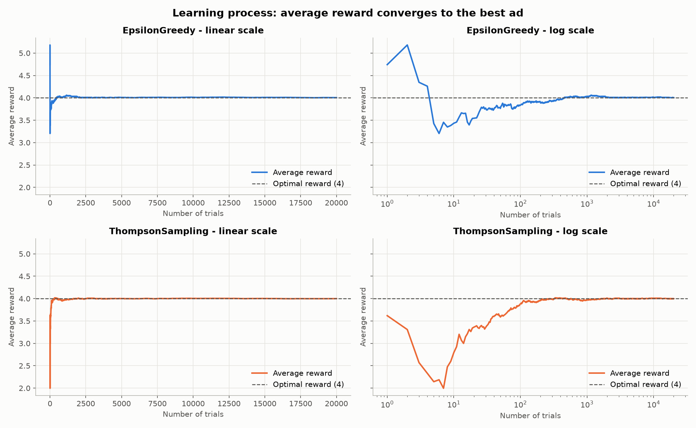
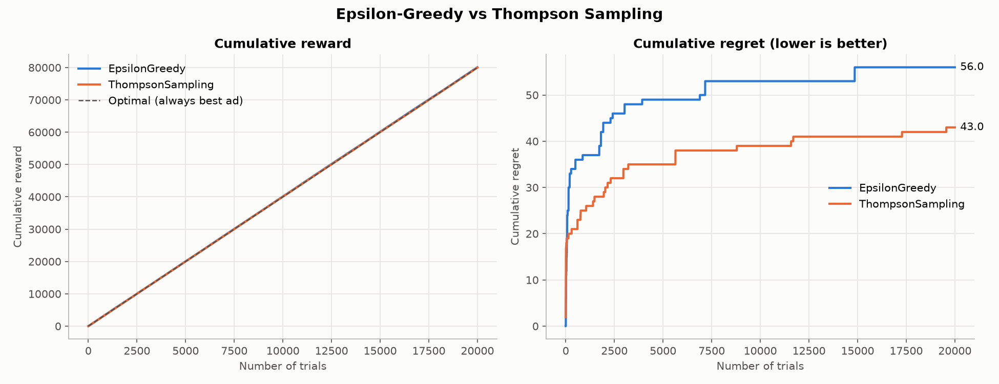
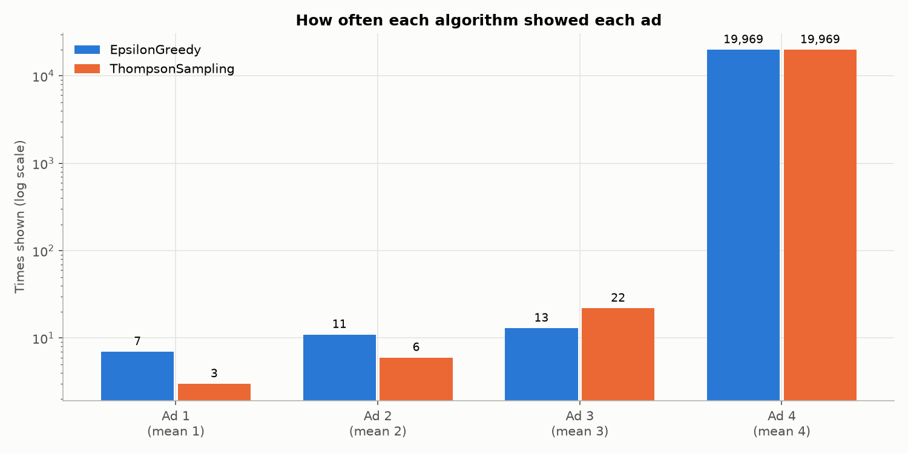

# HW2 – A/B Testing with Multi-Armed Bandits

Epsilon-Greedy vs Thompson Sampling on four advertisements with Gaussian rewards
(true means `[1, 2, 3, 4]`, known precision τ = 1), 20,000 trials each.

## How to Run
```bash
pip install -r requirements.txt
python Bandit.py
```
Outputs are written to `outputs/`: `bandit_rewards.csv` ({Bandit, Reward, Algorithm})
and three figures.

## Design Decisions
| Choice | Value | Why |
|---|---|---|
| Reward model | N(μ, 1/τ), τ = 1 | Gaussian rewards, as in the lecture's Thompson Sampling section |
| Epsilon | ε_t = min(1, 5/t) | Decays as 1/t. Plain 1/t explores only ~10 times in 20,000 trials and stayed on a sub-optimal ad in ~12% of 200 simulated seeds; scaling by ε₀ = 5 removed this |
| Thompson prior | μ ~ N(0, 1/0.01) | Vague prior (sd = 10). With a tight N(0, 1) prior, an untried ad samples near 0 and almost never beats an ad worth ≈3, so the best ad could stay untested for thousands of trials (regret up to 3,863 over 200 seeds). The vague prior cut the worst case to 52 |
| Regret | Σ (μ* − μ_chosen) | Expected regret: non-negative and not distorted by reward noise |
| Seed | 12 | Reproducible results |

## Results
| Algorithm | Cumulative reward | Cumulative regret | Best ad shown |
|---|---|---|---|
| Epsilon-Greedy | 80,080.41 | 56.0 | 99.84% |
| Thompson Sampling | 79,992.84 | 43.0 | 99.84% |

Thompson Sampling has lower regret: it shows bad ads only while their posteriors still
overlap with the best ad, while Epsilon-Greedy keeps exploring at random. Epsilon-Greedy's
higher cumulative reward here is reward noise, which is why regret is measured with true
means. Across 200 seeds the average regret is 31 for Thompson Sampling and 75 for
Epsilon-Greedy.





## Bonus: The Better Implementation Plan
1. **Separate arms from strategies.** The template puts `pull`, `experiment` and `report`
   on one `Bandit` class. A cleaner design has an `Arm` (reward source), a `Strategy`
   (`select_arm()`, `update(arm, reward)`) and an `Experiment` runner that handles
   logging, CSV and plots. Adding UCB1 would then mean writing only one small class.
2. **Make the abstract signatures honest.** `pull(self, arm)` and `update(self, arm, reward)`
   should be declared in the base class, so subclasses do not have to change them.
3. **Evaluate over many runs, not one.** A single seed can be lucky. Repeat each
   algorithm over e.g. 200 seeds and report mean regret with a confidence band.
4. **Use a safer epsilon schedule.** Plain 1/t can lock onto a bad ad early. Scale it
   (ε₀/t), or first show every ad a few times before decaying.
5. **Match the model to real ad data.** Real variance is unknown, so use a
   Normal-Gamma prior (unknown mean and precision). For click data, use Beta-Bernoulli
   Thompson Sampling.
6. **Add baselines and a stopping rule.** Compare against UCB1 and a classic A/B test,
   and stop the experiment once P(best ad) > 95%.